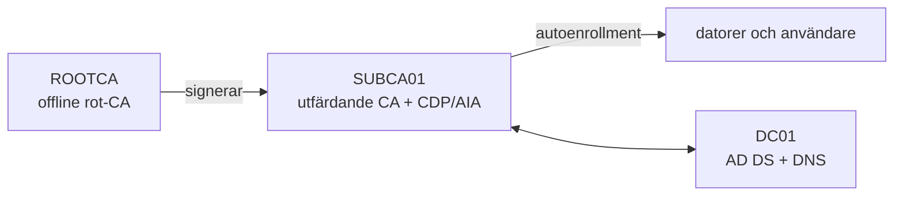

# PKI-labb för Testby kommun – etapp 1: AD och tvånivå-PKI

En komplett, skriptad labbmiljö med Active Directory och en tvånivå-PKI på Microsoft AD CS, byggd för en fiktiv kommun. Projektet visar både hur PKI:n byggs och hur den förvaltas och granskas: arkitekturen är motiverad i ett eget dokument, installationen är automatiserad i PowerShell, och två verktyg övervakar certifikatens livslängd och granskar säkerheten i certifikatmallarna.

## Vad som ingår

```
pki-labb/
├── lab-config.psd1                     Namn, IP-adresser och domän på ett ställe
├── lib/LabCommon.psm1                  Gemensamma hjälpfunktioner
├── scripts/
│   ├── 01-DC01-Install.ps1             Domänkontrollant, DNS, OU:er, testkonton
│   ├── 02-ROOTCA-Install.ps1           Fristående offline-rot-CA
│   ├── 03-SUBCA-Install.ps1            IIS för CDP/AIA och utfärdande enterprise-CA
│   ├── 04-ROOTCA-SignSubCA.ps1         Signering av den utfärdande CA:n
│   ├── 05-SUBCA-Complete.ps1           Slutkonfiguration och HTTP-verifiering
│   └── 06-SUBCA-PublishTemplates.ps1   Mallpublicering och GPO för autoenrollment
├── tools/
│   ├── Get-PkiExpiryReport.ps1         Varnar för certifikat och CRL:er som snart löper ut
│   └── Test-AdcsTemplateSecurity.ps1   Granskar mallar och CA:er efter ESC1–ESC15
└── docs/
    ├── 01-arkitektur-och-motivering.md Designval, alternativ och avvägningar
    └── 02-bygginstruktion.md           Steg för steg, inklusive felsökning
```

## Arkitektur



| Server | Roll | IP |
|---|---|---|
| DC01 | AD DS och DNS för `testby.internal` | 10.10.10.10 |
| ROOTCA | Fristående rot-CA, avstängd och frånkopplad efter installation | 10.10.10.20 |
| SUBCA01 | Enterprise-CA, IIS med `http://pki.testby.internal/pki` | 10.10.10.30 |

Varför två nivåer, varför bara HTTP för spärrkontroll och hur giltighetstiderna hänger ihop står i [arkitekturdokumentet](docs/01-arkitektur-och-motivering.md).

## Verktygen

**Get-PkiExpiryReport.ps1** läser CA-databasen, certifikatarkiv på servrar och publicerade spärrlistor. Den skiljer på certifikat (varning i dagar), spärrlistor från online-CA:er (varning i timmar) och spärrlistor från offline-CA:er, som förnyas manuellt och därför varnar veckor i förväg. Avslutningskoden gör den lämplig som schemalagd aktivitet eller övervakningskontroll.

**Test-AdcsTemplateSecurity.ps1** granskar certifikatmallarnas flaggor, EKU:er och behörigheter och CA:ernas konfiguration mot de kända felkonfigurationerna ESC1–ESC4, ESC6, ESC8, ESC9 och ESC15. Varje fynd har en förklaring och en konkret åtgärd. Bygginstruktionen innehåller en demonstration där en sårbar mall skapas, upptäcks och åtgärdas.

Båda verktygen är skrivskyddade: de läser konfiguration och ändrar ingenting.

## Kom igång

Följ [bygginstruktionen](docs/02-bygginstruktion.md). Kortversion:

| Ordning | Server | Skript |
|---|---|---|
| 1 | DC01 | `01-DC01-Install.ps1` (tre körningar) |
| 2 | SUBCA01 | `03-SUBCA-Install.ps1` (två körningar: domänanslutning, förberedelser) |
| 3 | ROOTCA | `02-ROOTCA-Install.ps1` (två körningar), kopiera filer |
| 4 | SUBCA01 | `03-SUBCA-Install.ps1` (tredje körningen) |
| 5 | ROOTCA | `04-ROOTCA-SignSubCA.ps1`, stäng av |
| 6 | SUBCA01 | `05-SUBCA-Complete.ps1`, skapa mallar, `06-SUBCA-PublishTemplates.ps1` |

Krav: Hyper-V, Windows Server 2022 eller 2025 (utvärderingsversion räcker), cirka 10 GB RAM.

## Säkerhet

Det här är en labbmiljö. Nycklarna är mjukvarunycklar och rot-CA:n är en virtuell maskin; skillnaderna mot en produktionsmiljö är listade i arkitekturdokumentet. Checka aldrig in certifikatbegäranden, privata nycklar, exporterade certifikat eller lösenord; `.gitignore` utesluter de vanligaste filtyperna.

## Nästa etapper

2. Hybrid identitet: synkronisering till Microsoft Entra ID, villkorad åtkomst och certifikatbaserad inloggning med certifikat från den här PKI:n.
3. Federation: OIDC och SAML, med Keycloak som extern part.
4. Identitetslivscykel: provisionering från ett simulerat HR-system och SCIM.
5. Beställarperspektivet: kravspecifikation, granskning och beslutsunderlag.
