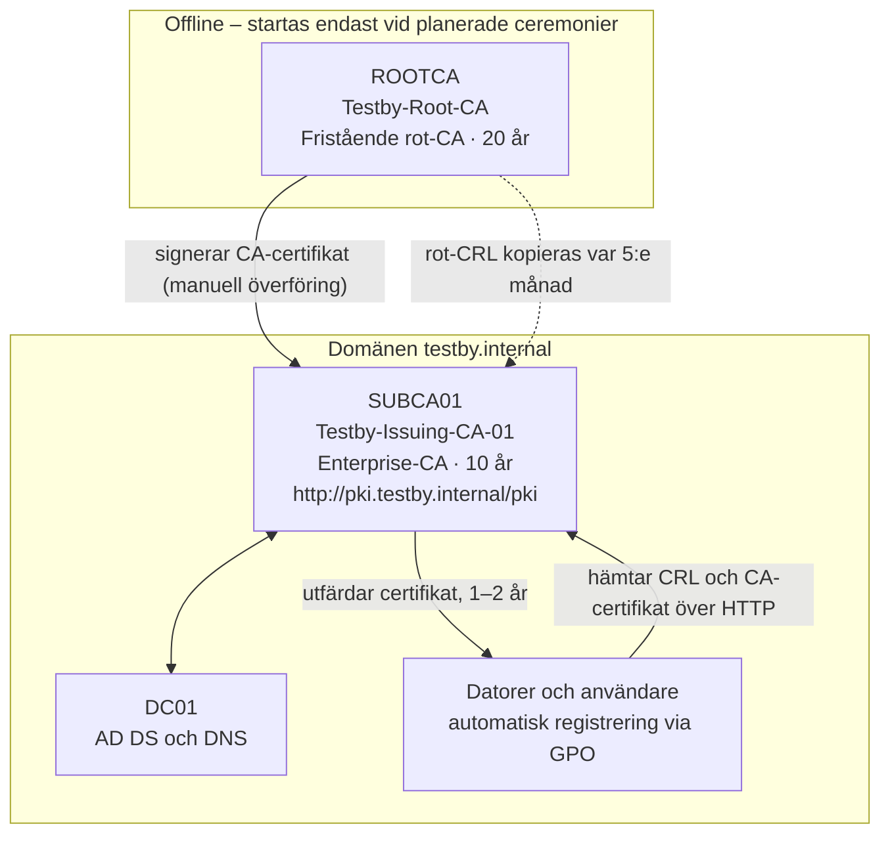

# Arkitektur och designmotivering – PKI för Testby kommun

Det här dokumentet beskriver och motiverar designen av labbmiljöns PKI. Det är skrivet som ett beslutsunderlag: varje val anges tillsammans med de alternativ som övervägdes och skälet till att de valdes bort. Där labbet avviker från vad jag skulle rekommendera i produktion står det uttryckligen.

## 1. Syfte och avgränsning

PKI:n ska utfärda certifikat för datorautentisering, användarautentisering (bland annat certifikatbaserad inloggning mot Microsoft Entra ID i etapp 2) och TLS på interna webbtjänster. Den ska vara enkel att förvalta för en kommunal IT-organisation och gå att granska.

Utanför scope för etapp 1: OCSP, HSM, nyckelarkivering, registreringsagenter och smartkort, samt certifikat som ska vara betrodda utanför organisationen (dessa köps från en publik CA).

## 2. Översikt

## 3. Val av hierarki

| Alternativ | Fördelar | Nackdelar | Bedömning |
|---|---|---|---|
| En nivå (rot-CA som också utfärdar) | Enkel, en server | Rotnyckeln måste vara online. Om den komprometteras måste hela PKI:n byggas om och rotcertifikatet bytas ut på alla klienter. | Avvisad |
| **Två nivåer (offline-rot + utfärdande CA)** | Rotnyckeln är skyddad offline. En komprometterad utfärdande CA kan spärras och ersättas utan att roten byts. Standardmönster med gott stöd i dokumentation och verktyg. | Kräver rutiner för offline-roten (CRL-förnyelse, ceremonier). | **Vald** |
| Tre nivåer (rot + policy-CA + utfärdande CA) | Separata policyer per verksamhetsområde eller juridisk enhet | Mer infrastruktur och fler ceremonier. Motiveras främst i mycket stora organisationer eller när olika certifikatpolicyer måste hållas isär formellt. | Avvisad – överdimensionerad för en kommun |

Tvånivåhierarkin är den rimliga balansen mellan säkerhet och förvaltningsbarhet. Det avgörande argumentet är att rotnyckeln – det mest skyddsvärda i hela PKI:n – aldrig behöver finnas på ett nätverk. Den utfärdande CA:n är däremot domänansluten (enterprise-CA), vilket krävs för certifikatmallar, automatisk registrering och integration med AD.

Om kommunen senare behöver en separat CA, till exempel för skolans miljö eller för en driftpartner, kan ytterligare en utfärdande CA signeras av samma rot utan att befintliga certifikat påverkas.

## 4. Giltighetstider

| Certifikat | Giltighet | Motivering |
|---|---|---|
| Rot-CA | 20 år | Lång livslängd minskar hur ofta rotcertifikatet måste distribueras om. |
| Utfärdande CA | 10 år | Hälften av rotens livslängd. Förnyas efter cirka 5 år så att den alltid har längre kvar än de certifikat den utfärdar. |
| Slutcertifikat | 1 år (mallarna), tak 2 år på CA:n | Kort livslängd begränsar konsekvensen av en röjd nyckel. Automatisk förnyelse gör att kort livslängd inte kostar förvaltningstid. |

Grundregeln är att ett certifikat aldrig kan bli giltigt längre än sin utfärdare. Därför förnyas varje CA-certifikat senast vid halva livslängden.

## 5. Spärrkontroll (CDP och AIA)

Spärrlistor och CA-certifikat publiceras **enbart över HTTP** på `http://pki.testby.internal/pki/`. LDAP-publicering (standard i AD CS) har tagits bort.

Skälen är att HTTP fungerar för klienter som inte är domänanslutna, att det går att publicera externt senare (vilket krävs för certifikatbaserad inloggning i Entra ID, där spärrlistan måste nås från internet) och att det blir en enda plats att övervaka. HTTP utan TLS är avsiktligt: spärrlistor och certifikat är signerade och kan inte manipuleras obemärkt, och TLS skulle skapa ett cirkulärt beroende där spärrkontrollen kräver ett certifikat som i sin tur kräver spärrkontroll.

Adressen är ett DNS-alias (`pki`) och inte servernamnet. Aliaset är inbäddat i alla utfärdade certifikat, så den utfärdande CA:n kan flyttas eller publiceringen läggas på en annan webbserver utan att certifikat måste utfärdas om.

| | Bas-CRL | Överlapp | Delta-CRL |
|---|---|---|---|
| Rot-CA | 26 veckor | 2 veckor | Ingen |
| Utfärdande CA | 1 vecka | 3 dagar | 1 dygn (12 timmars överlapp) |

Rot-CA:n spärrar i praktiken bara underordnade CA:er, vilket sker sällan, så en lång CRL-period är rimlig. Den utfärdande CA:n spärrar slutcertifikat, och delta-CRL gör att en spärr får effekt inom ett dygn.

**Den största driftrisken i designen är att rot-CRL:en löper ut.** Om den gör det misslyckas spärrkontrollen för hela kedjan och certifikatbaserad autentisering slutar fungera. Därför övervakas den särskilt av `Get-PkiExpiryReport.ps1` och förnyelsen är en schemalagd rutin (avsnitt 9).

OCSP ingår inte i etapp 1. Det minskar svarstider och nätverkstrafik vid stora volymer och bör övervägas i produktion.

## 6. Nyckelskydd och kryptografi

Nycklarna genereras med Microsoft Software Key Storage Provider. Rot och utfärdande CA använder RSA 4096 och SHA-256, slutcertifikat RSA 2048. RSA har valts framför ECC för bredast möjliga kompatibilitet med äldre system och nätverksutrustning, vilket är vanligt i kommunala miljöer.

**Avvikelse från produktion:** i produktion bör rotnyckeln och den utfärdande CA:ns nyckel skyddas av en HSM (fysisk eller molnbaserad), och rotceremonier bör genomföras med två personer och protokoll.

## 7. Namnrymd

AD-domänen heter `testby.internal`. Toppdomänen `.internal` reserverades av ICANN 2024 för privata nätverk och kan därmed aldrig krocka med en publik domän, till skillnad från det tidigare vanliga `.local` som också används av mDNS.

En icke-routbar domän kan inte verifieras i Entra ID. I etapp 2 läggs därför ett routbart UPN-suffix till för användarna.

## 8. Certifikatmallar och behörigheter

Mallarna följer principen att **ämnesnamnet byggs från AD** för alla mallar som ger klientautentisering. Ansökaren kan alltså inte själv bestämma vem certifikatet gäller. Det är den viktigaste enskilda åtgärden mot den vanligaste klassen av AD CS-attacker (ESC1).

| Mall | Användning | Ämnesnamn | Får registrera |
|---|---|---|---|
| LabDator | Datorautentisering, 802.1X | Från AD (DNS-namn) | Domain Computers (automatiskt) |
| LabAnvandare | Användarautentisering, CBA mot Entra ID | Från AD (UPN i SAN) | Domain Users (automatiskt) |
| LabWebbserver | TLS för interna webbtjänster | Anges i begäran | PKI-Webbserver-Registrerare, kräver godkännande |

Webbservermallen måste tillåta att ansökaren anger namn, eftersom servrarnas DNS-namn inte finns i AD i rätt form. Den har därför bara EKU:n Server Authentication (inte klientautentisering), en smal grupp som får registrera sig och krav på godkännande av certifikathanterare.

Inga standardmallar publiceras (`LoadDefaultTemplates=0`). Varje publicerad mall är ett medvetet beslut.

`Test-AdcsTemplateSecurity.ps1` kontrollerar att dessa principer håller och körs efter varje mallförändring.

## 9. Granskning och förvaltning

Granskning av CA-händelser är påslagen (`AuditFilter=127` och underkategorin Certification Services). De viktigaste händelserna i säkerhetsloggen är 4886 (begäran mottagen), 4887 (certifikat utfärdat), 4888 (begäran nekad), 4898–4900 (mall laddad, ändrad eller ändrade behörigheter). I produktion skickas de till organisationens SIEM.

| Uppgift | Intervall | Hur |
|---|---|---|
| Kontroll av certifikat och CRL | Dagligen | `Get-PkiExpiryReport.ps1` som schemalagd aktivitet |
| Säkerhetsgranskning av mallar | Vid förändring och kvartalsvis | `Test-AdcsTemplateSecurity.ps1` |
| Förnya rot-CRL | Var 5:e månad (senast vecka 24 av 26) | Starta ROOTCA, `certutil -crl`, kopiera till C:\pki |
| Förnya utfärdande CA-certifikat | Efter cirka 5 år | Ny nyckel, signeras av roten |
| Förnya rot-CA-certifikat | Efter cirka 10 år | Planeras som projekt; nytt rotcertifikat distribueras via GPO/Intune |

## 10. Kända begränsningar i labbet

Labbet skiljer sig från en produktionsmiljö på följande punkter, som alla är medvetna förenklingar:

| Område | Labb | Produktion |
|---|---|---|
| Rotnyckel | Mjukvarunyckel på en virtuell maskin | HSM, rot på fristående fysisk eller strikt isolerad virtuell maskin |
| Offline-rot | Nätverkskortet kopplas bort efter installation | Aldrig ansluten till nätverk; överföring med kontrollerat medium |
| Redundans | En utfärdande CA, en webbserver för CDP | Minst två publiceringspunkter, ev. två utfärdande CA:er |
| Spärrkontroll | Endast CRL | CRL och OCSP |
| Ceremonier | Utförs av en person | Två personer, protokoll, dokumenterad nyckelhantering |
| Policydokument | Detta dokument | Certifikatpolicy (CP) och CPS |
